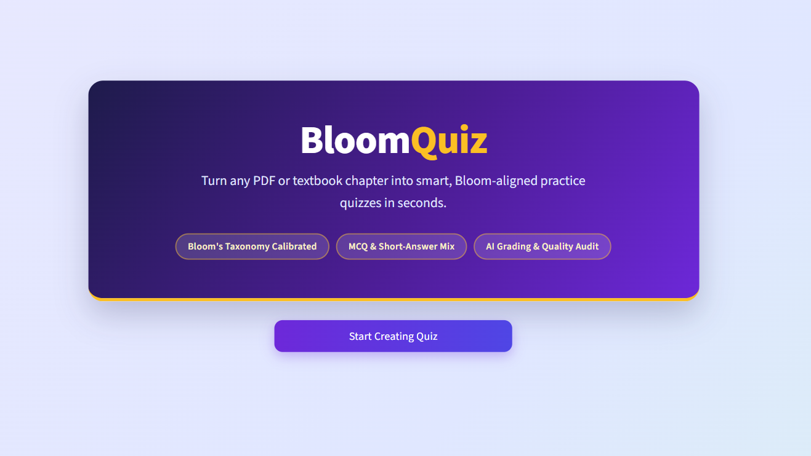
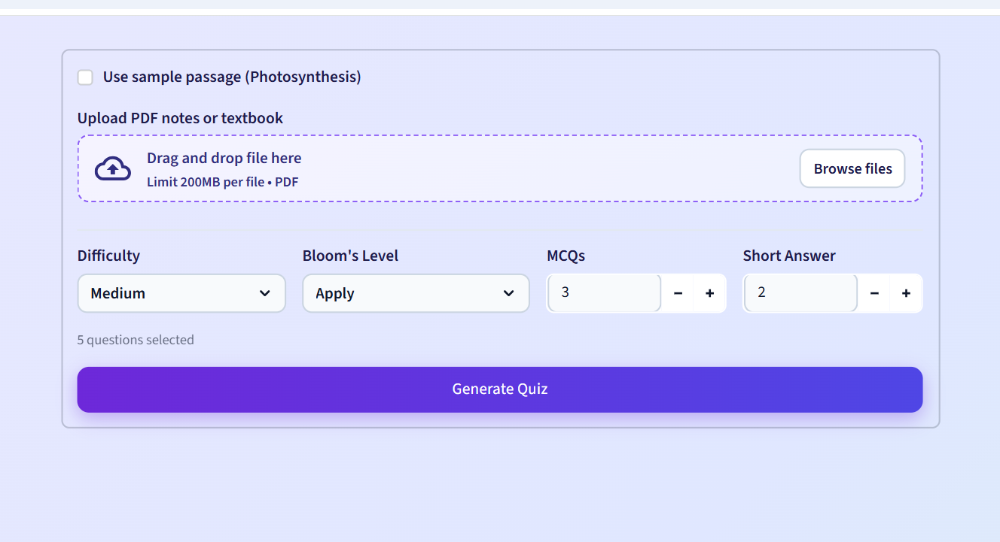
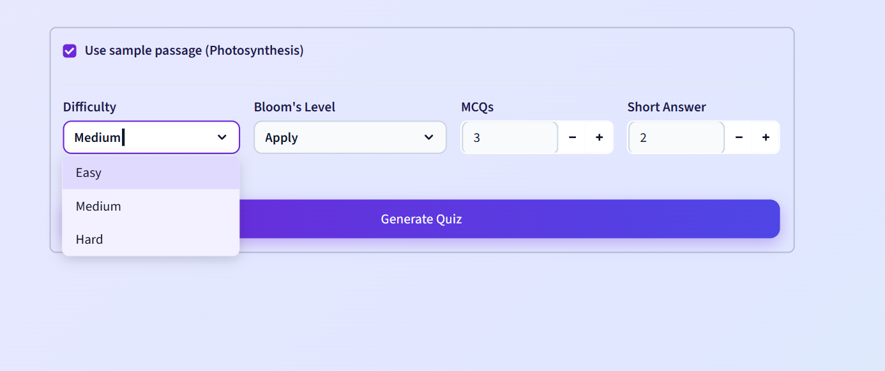
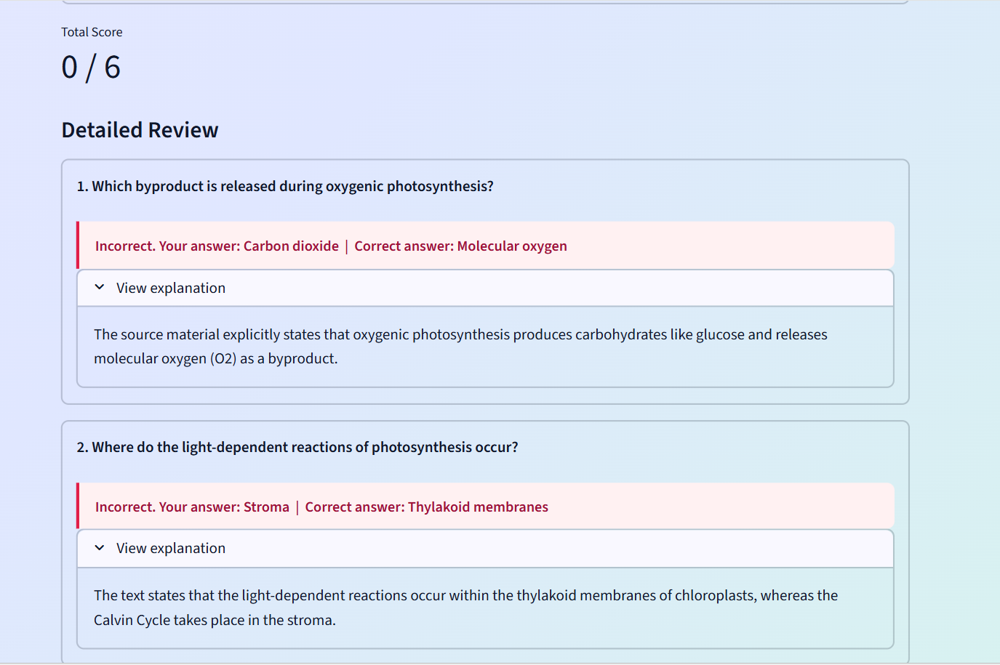

# BloomQuiz

**Turn any PDF or textbook chapter into smart, Bloom-aligned practice quizzes in seconds.**

BloomQuiz is an AI-powered assessment generation, interactive practice, and quality-auditing web application built with Python, Streamlit, PyMuPDF, and Google's official `google-genai` SDK powered by **Gemini 3.8 Flash**.

---

## Key Features

### 1. Hybrid PDF Extraction & Scanned Document Vision Fallback
- **Direct Text Extraction**: Fast text parsing across user-selected page ranges using PyMuPDF (`pymupdf`), trimmed to 8,000 characters for low-latency generation.
- **Scanned PDF Vision Fallback**: Automatically detects image-only or scanned pages (< 50 extracted characters), renders them as PNG images, and routes them directly to Gemini's multimodal vision pipeline.

### 2. Bloom's Taxonomy Calibrated Question Generation
- Powered by the official `google-genai` SDK with `gemini-3.8-flash` and strict **Pydantic v2 (`response_schema`)** structured output.
- **Cognitive Depth Alignment**: Target any level of Bloom's Taxonomy — *Remember*, *Understand*, *Apply*, *Analyze*, *Evaluate*, or *Create*.
- **Customizable Difficulty & Mix**: Configure *Easy*, *Medium*, or *Hard* difficulty with custom counts for **Multiple Choice Questions (MCQ)** and **Short Answer** questions.
- **Evidence-Grounded Explanations**: Every question includes an explanation strictly anchored in the uploaded source material.

### 3. Interactive Practice & AI Short-Answer Grading
- **Instant MCQ Scoring**: Automatic grading with immediate visual feedback and explanations.
- **AI Short-Answer Evaluation**: Batch-evaluates typed student responses against reference model answers using Gemini, assigning *Correct (1.0)*, *Partial (0.5)*, or *Incorrect (0.0)* verdicts with personalized feedback.

### 4. On-Demand LLM-as-a-Judge Quality Audit
- Independent psychometric evaluation pass (`evaluate_questions()`) that audits every generated question on a 1–5 scale across:
  - **Factual Correctness**: Strict grounding in the source material with zero hallucinations.
  - **Distractor Quality**: Plausibility and distinctness of MCQ distractors.
  - **Bloom Alignment**: Accuracy to the selected cognitive level.
  - **Per-Question Critiques**: Actionable one-sentence feedback for each item.

### 5. Publication-Ready PDF & CSV Exports
- **Printable PDF (`fpdf2`)**: Generates a formatted multi-part assessment containing the question paper (Part I), a dedicated Answer Key & Explanations page (Part II), and the Quality Audit Report (Part III), with full Latin-1 Unicode sanitization.
- **Structured CSV (`pandas`)**: Exports questions, options A–D, answer keys, explanations, and quality audit metrics in UTF-8 format.

---

## Screenshots

### Welcome & Quiz Configuration



### Difficulty & Bloom's Taxonomy Controls



### Interactive Practice & AI Grading


### LLM-as-a-Judge Quality Audit


## Project Structure

```text
BloomQuiz/
├── .streamlit/
│   └── config.toml         # Custom SaaS theme configuration
├── app.py                  # Main Streamlit web application & UI
├── generator.py            # Gemini 3.8 Flash generator, AI grader & LLM judge
├── exporter.py             # Printable PDF (fpdf2) and CSV (pandas) exporter
├── requirements.txt        # Python dependencies
├── .env.example            # Environment variable template
├── .gitignore              # Git ignore rules (.env, venv, cache)
└── README.md               # Project documentation
